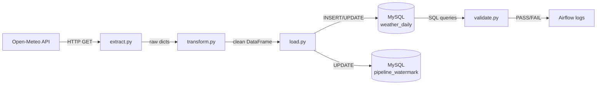

# Weather ETL Pipeline 🌦️

A **beginner-friendly data engineering project** that fetches daily weather data for 5 Indian cities from the free [Open-Meteo API](https://open-meteo.com), transforms it with pandas, and loads it into a MySQL database — orchestrated by Apache Airflow.

---

## 📐 Architecture

```
┌─────────────────────────────────────────────────────────────────────┐
│                        Apache Airflow (Docker)                      │
│                                                                     │
│   ┌───────────────┐    ┌───────────────┐    ┌──────────────────┐   │
│   │  extract_task │───▶│transform_task │───▶│   load_task      │   │
│   │               │    │               │    │                  │   │
│   │ Open-Meteo API│    │ pandas clean, │    │ INSERT ... ON    │   │
│   │ (5 cities)    │    │ rename, dedup │    │ DUPLICATE KEY    │   │
│   │ Watermark read│    │ add timestamp │    │ UPDATE           │   │
│   └───────────────┘    └───────────────┘    └──────────────────┘   │
│                                                       │             │
│                                            ┌──────────▼──────────┐  │
│                                            │   validate_task     │  │
│                                            │                     │  │
│                                            │ ✅ row count check  │  │
│                                            │ ✅ null check       │  │
│                                            │ ✅ duplicate check  │  │
│                                            └─────────────────────┘  │
└─────────────────────────────────────────────────────────────────────┘
                                    │
                                    ▼
                    ┌───────────────────────────────┐
                    │      MySQL (Docker)            │
                    │                               │
                    │  TABLE: weather_daily         │
                    │  (city, date) UNIQUE KEY      │
                    │                               │
                    │  TABLE: pipeline_watermark    │
                    │  (last loaded date per city)  │
                    └───────────────────────────────┘
```

**Data flow (Mermaid):**



---

## 📁 Project Structure

```
API_to_warehouse_pipeline/
│
├── docker-compose.yml          # MySQL + Airflow in Docker
├── requirements.txt            # Python dependencies
├── README.md                   # This file
│
├── sql/
│   └── create_tables.sql       # DB schema (run automatically by Docker)
│
├── src/                        # ETL logic (pure Python, no Airflow dependency)
│   ├── __init__.py             # Makes src/ a Python package
│   ├── extract.py              # Step 1: Fetch from Open-Meteo API
│   ├── transform.py            # Step 2: Clean with pandas
│   ├── load.py                 # Step 3: Load into MySQL (idempotent)
│   └── validate.py             # Step 4: Data quality checks
│
├── dags/
│   └── weather_pipeline_dag.py # Airflow DAG definition
│
└── logs/                       # Pipeline log files (auto-created)
```

---

## 🚀 Setup & Run Instructions

### Prerequisites
- [Docker Desktop](https://www.docker.com/products/docker-desktop/) installed and running
- Git (to clone the repo)
- Internet connection (for Open-Meteo API)

### Step 1: Clone the repository

```bash
git clone <your-repo-url>
cd API_to_warehouse_pipeline
```

### Step 2: Create the logs directory

```bash
mkdir logs
```

### Step 3: Start all services

```bash
docker compose up -d
```

This starts 6 containers:
- `weather_mysql` — MySQL database on port **3307**
- `airflow_postgres` — Airflow's internal PostgreSQL
- `airflow_init` — Runs once to set up Airflow (then exits)
- `airflow_webserver` — Web UI at **http://localhost:8080**
- `airflow_scheduler` — Triggers and runs DAG tasks
- `airflow_triggerer` — Handles async Airflow tasks

> ⏳ First startup takes **3–5 minutes** because Docker pulls images and installs dependencies.

### Step 4: Check that all services are running

```bash
docker compose ps
```

You should see all services as `Up` or `healthy`.

### Step 5: Verify MySQL tables were created

```bash
docker exec -it weather_mysql mysql -u weather_user -pweather_pass weather_db -e "SHOW TABLES;"
```

Expected output:
```
+----------------------+
| Tables_in_weather_db |
+----------------------+
| pipeline_watermark   |
| weather_daily        |
+----------------------+
```

### Step 6: Open the Airflow UI

1. Go to **http://localhost:8080**
2. Login: `admin` / `admin`
3. Find **`weather_daily_pipeline`** in the DAG list
4. Toggle the DAG **ON** (the toggle on the left)
5. Click **▶ Trigger DAG** to run it immediately

### Step 7: Monitor the run

- Click on the DAG name → **Grid View** to see task statuses
- Green = success, Red = failed, Yellow = running
- Click any task → **Logs** to see detailed output

### Step 8: Verify data was loaded

```bash
docker exec -it weather_mysql mysql -u weather_user -pweather_pass weather_db \
  -e "SELECT city, date, max_temp_c, min_temp_c FROM weather_daily ORDER BY date DESC LIMIT 10;"
```

---

## 🛑 Stop Everything

```bash
docker compose down
```

To also **delete all data** (MySQL tables will be recreated fresh next time):

```bash
docker compose down -v
```

---

## 🔄 How Idempotency Works

**Idempotency** means you can run the pipeline as many times as you want and you'll always end up with the same data — no duplicates.

**How we achieve it:**
1. The `weather_daily` table has a `UNIQUE KEY (city, date)`.
2. We use `INSERT ... ON DUPLICATE KEY UPDATE` instead of plain `INSERT`.
3. If a row for `(Delhi, 2024-01-15)` already exists:
   - MySQL does NOT insert a new row
   - MySQL UPDATES the existing row with the new values

```sql
-- What happens on a re-run (simplified):
INSERT INTO weather_daily (city, date, max_temp_c, ...)
VALUES ('Delhi', '2024-01-15', 25.0, ...)
ON DUPLICATE KEY UPDATE     -- ← This is the magic
    max_temp_c = VALUES(max_temp_c),  -- Updates the value instead of failing
    ...
```

---

## 📈 How the Watermark Works (Incremental Loading)

**The problem:** We don't want to re-fetch ALL historical data every day. We only want to fetch new data.

**The solution:** A `pipeline_watermark` table that remembers the last date we loaded for each city.

**How it works:**
1. **First run:** No watermark → fetch last 30 days (backfill)
2. **End of run:** Save `max(date)` per city into `pipeline_watermark`
3. **Next run:** Read the watermark → fetch only from `(watermark_date + 1 day)` onwards

```
Run 1 (first run):
  Watermark: None → start = today - 30 days
  Fetches: Jan 1 to Jan 31
  Saves watermark: Jan 31

Run 2 (next day):
  Watermark: Jan 31 → start = Feb 1
  Fetches: Feb 1 (just one day)
  Saves watermark: Feb 1
```

Check the watermark:
```sql
SELECT city, last_loaded_date, updated_at FROM pipeline_watermark;
```

---

## 🔁 How Retries Work

Each API call in `extract.py` retries up to **3 times** with a **5-second delay**:

```python
for attempt in range(1, MAX_RETRIES + 1):  # 1, 2, 3
    try:
        response = requests.get(url, params=params, timeout=10)
        response.raise_for_status()
        return response.json()          # ← Success, stop retrying
    except Exception:
        if attempt < MAX_RETRIES:
            time.sleep(RETRY_DELAY_SECONDS)  # Wait 5s then try again

return None  # All 3 retries failed
```

If one city fails all retries, we **log the error and continue** with the other cities. One bad city won't kill the whole pipeline.

Additionally, Airflow itself retries failed tasks **2 more times** with a **5-minute delay** (configured in `default_args` of the DAG).

---

## 📊 Sample SQL Queries

**View latest weather data:**
```sql
SELECT city, date, max_temp_c, min_temp_c, precipitation_mm, wind_speed_kmh
FROM weather_daily
ORDER BY date DESC, city
LIMIT 20;
```

**Check data for a specific city:**
```sql
SELECT * FROM weather_daily
WHERE city = 'Delhi'
ORDER BY date DESC;
```

**Compare cities on the same date:**
```sql
SELECT city, date, max_temp_c, min_temp_c, precipitation_mm
FROM weather_daily
WHERE date = CURDATE() - INTERVAL 1 DAY
ORDER BY max_temp_c DESC;
```

**Hottest day per city:**
```sql
SELECT city, date, max_temp_c
FROM weather_daily
WHERE (city, max_temp_c) IN (
    SELECT city, MAX(max_temp_c) FROM weather_daily GROUP BY city
)
ORDER BY max_temp_c DESC;
```

**Check watermarks (last loaded date per city):**
```sql
SELECT city, last_loaded_date, updated_at
FROM pipeline_watermark;
```

**How many rows per city?**
```sql
SELECT city, COUNT(*) AS total_rows,
       MIN(date) AS earliest_date,
       MAX(date) AS latest_date
FROM weather_daily
GROUP BY city;
```

**Find any duplicates (should be empty):**
```sql
SELECT city, date, COUNT(*) as cnt
FROM weather_daily
GROUP BY city, date
HAVING COUNT(*) > 1;
```

---

## ❓ What Happens if the Pipeline Fails Midway?

This is a common interview question! Here's exactly what happens:

### Scenario 1: Extract fails (API is down)

- Airflow retries the `extract_task` up to 2 more times (3 total)
- Each retry waits 5 minutes
- If all retries fail, Airflow marks the task as `FAILED`
- `transform_task`, `load_task`, and `validate_task` are **skipped** (downstream tasks don't run)
- The **watermark is NOT updated** — next run will retry the same date range
- **No data corruption** — nothing was written to the DB

### Scenario 2: Transform fails (unexpected data format)

- Airflow retries `transform_task` up to 2 more times
- `load_task` and `validate_task` are skipped
- The watermark is NOT updated
- Next run re-fetches and re-transforms the same data
- **Safe** because load is idempotent

### Scenario 3: Load fails midway (DB connection dropped)

- The load runs inside a **database transaction** (`engine.begin()`)
- If the transaction fails partway through, MySQL **rolls back all changes** automatically
- The watermark is NOT updated (we only update it after a successful load)
- Next run re-fetches and re-loads the same data — no duplicates thanks to `ON DUPLICATE KEY UPDATE`

### Scenario 4: Validate fails (data quality issue)

- The data **is already in the DB** (load succeeded)
- Airflow marks `validate_task` as `FAILED` and sends an alert
- You can manually investigate the data with SQL queries
- Fix the issue and re-run just the `validate_task` from the Airflow UI

### Summary Table

| Failure Point | Data in DB? | Watermark Updated? | Next Run Behavior |
|---|---|---|---|
| Extract fails | ❌ No | ❌ No | Re-fetches same date range |
| Transform fails | ❌ No | ❌ No | Re-fetches same date range |
| Load fails | ⚠️ Partial (rolled back) | ❌ No | Re-loads same data (safe) |
| Validate fails | ✅ Yes | ✅ Yes | Loads only new data |

---

## 🗂️ File Explanations (For Interview Prep)

| File | What it does (simple explanation) |
|---|---|
| `docker-compose.yml` | Defines all the Docker containers we need: MySQL (our database) and Airflow (our scheduler). Like a recipe for our infrastructure. |
| `sql/create_tables.sql` | SQL commands that create the database tables. The UNIQUE KEY is what prevents duplicate data. |
| `src/extract.py` | Calls the Open-Meteo weather API for each city, handles errors, and retries failed calls. |
| `src/transform.py` | Cleans the raw API data using pandas: renames columns, fixes data types, removes nulls and duplicates. |
| `src/load.py` | Writes cleaned data to MySQL using an INSERT that also handles updates (idempotent). Updates the watermark after loading. |
| `src/validate.py` | Checks the data quality after loading: row count, nulls, and duplicates. Reports PASS/FAIL. |
| `dags/weather_pipeline_dag.py` | Tells Airflow to run extract→transform→load→validate every day, with retries on failure. |

---

## 🛠️ Troubleshooting

**Services not starting?**
```bash
docker compose logs airflow-init
docker compose logs mysql
```

**Can't see the DAG in Airflow?**
```bash
docker compose logs airflow-scheduler | grep weather
```

**MySQL connection refused?**
- Wait 2-3 more minutes for MySQL to fully start
- Check: `docker compose ps` — mysql should show `healthy`

**Reset everything and start fresh:**
```bash
docker compose down -v  # Deletes all data
docker compose up -d    # Starts fresh
```
